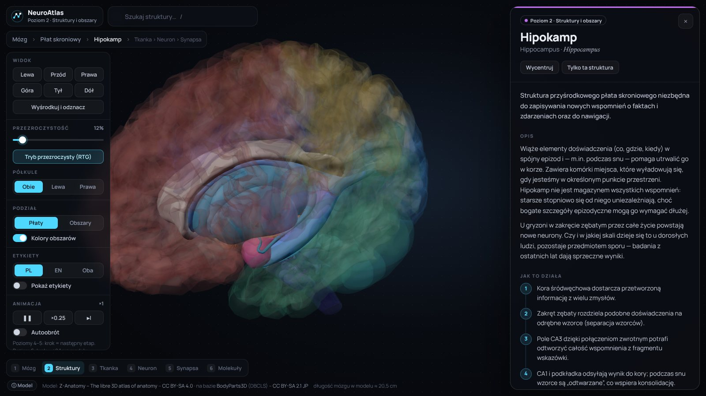
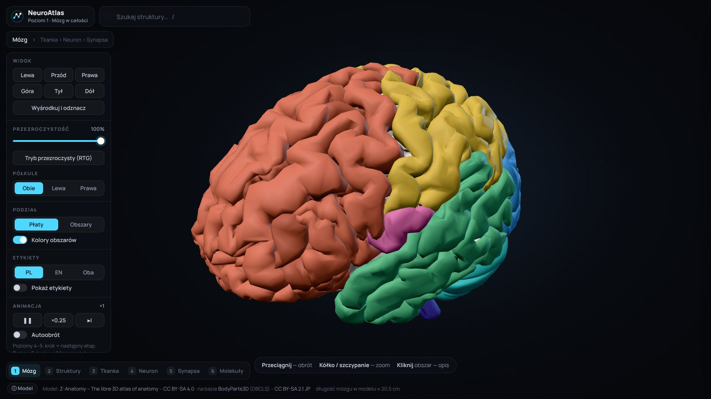
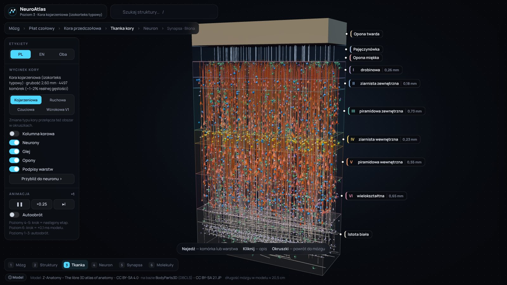
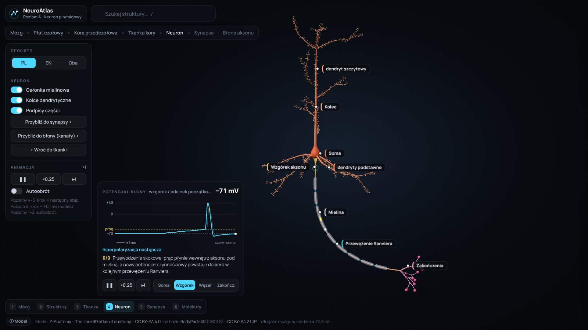
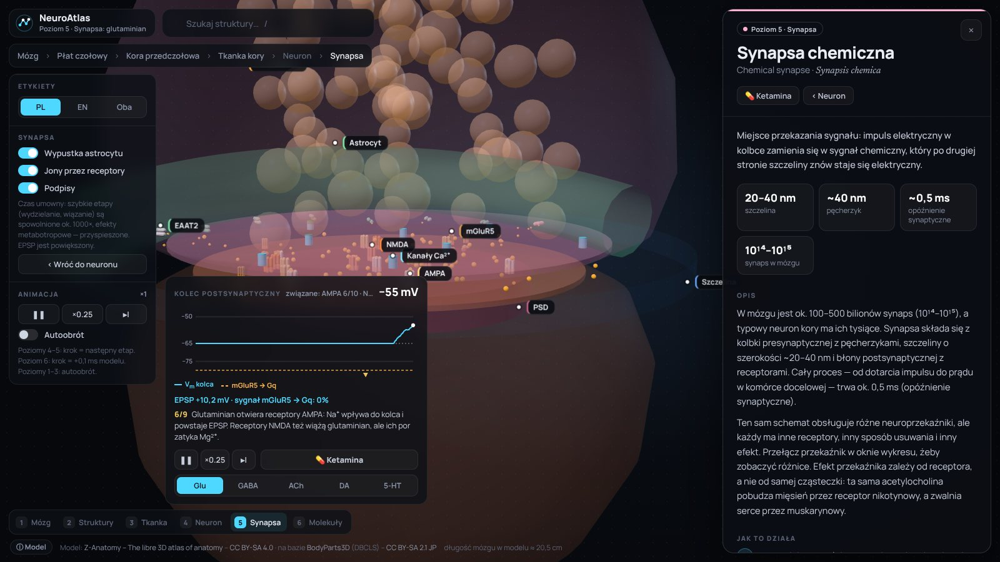
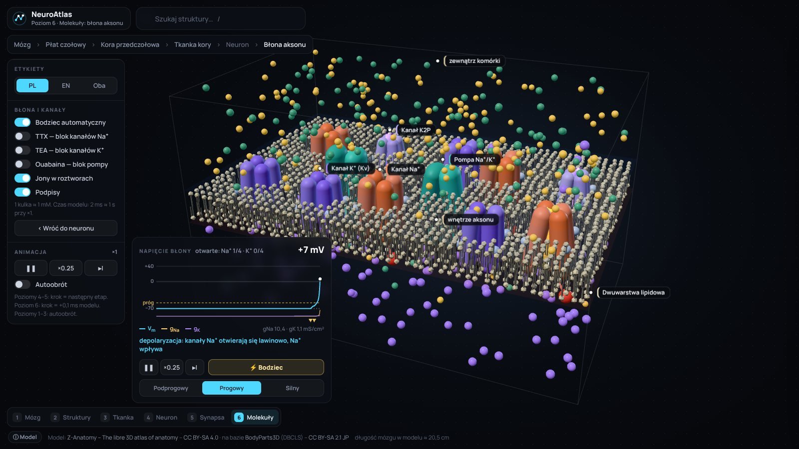

# NeuroAtlas 🧠

**Interaktywny atlas mózgu 3D w przeglądarce: od całego mózgu do kanałów jonowych w błonie neuronu.**
Po polsku i angielsku, bez instalacji, działa na komputerze i telefonie.

### ▶ [Otwórz NeuroAtlas](https://dominik881-creator.github.io/neuroatlas/)



## Sześć poziomów skali

Przybliżasz płynnie, krok po kroku, jak w mikroskopie:

| | |
|---|---|
|  **1. Mózg** – płaty, móżdżek, pień mózgu |  **2. Struktury głębokie** – hipokamp, wzgórze, jądra podstawy, komory, obszary kory |
|  **3. Tkanka kory** – 6 warstw, kolumny, neurony i glej |  **4. Neuron** – potencjał czynnościowy i przewodzenie skokowe |
|  **5. Synapsa** – 5 neuroprzekaźników, receptory, wychwyt zwrotny, leki |  **6. Błona** – kanały Na⁺/K⁺, pompa, model Hodgkina–Huxleya na żywo |

## Co potrafi

- **Najedź lub dotknij** struktury: nazwa PL / EN / łacińska i krótki opis.
- **Kliknij**: panel z opisem, „jak to działa” krok po kroku, skutki uszkodzenia, ciekawostka.
- **Animacje i symulacje**: potencjał czynnościowy, wydzielanie neuroprzekaźnika, zablokowanie kanałów (TTX, TEA, ouabaina), działanie ketaminy, benzodiazepin, SSRI, kokainy.
- **Wyszukiwarka**, okruszki nawigacji, etykiety PL/EN, suwak przezroczystości, play / pauza / ×0,25 / krok.
- Bez mitów o „10% mózgu” i „ludziach lewopółkulowych”. Realne skale i liczby, a uproszczenia wizualizacji są opisane wprost.

> Kod i opisy powstały przy pomocy AI (Claude, Anthropic). Jeśli znajdziesz błąd merytoryczny, zgłoś go w zakładce **Issues**. Każda poprawka się przyda.

## Uruchomienie u siebie

Strona wczytuje `brain.glb` obok pliku `index.html`, więc potrzebuje prostego serwera (podwójne kliknięcie w plik nie wystarczy):

```
python -m http.server 8000
```
i otwórz http://localhost:8000. Model można też przeciągnąć na stronę ręcznie.

## Aplikacja na Androida

Folder [`app/`](app/) zawiera projekt Capacitor, który pakuje NeuroAtlas jako aplikację offline. Instrukcja: [`app/INSTRUKCJA.md`](app/INSTRUKCJA.md).

## Technologia

Jeden plik HTML, bez kompilacji: [three.js](https://threejs.org/) 0.180, [three-mesh-bvh](https://github.com/gkjohnson/three-mesh-bvh) (szybkie wskazywanie na modelu ~320 tys. trójkątów), InstancedMesh dla tysięcy cząsteczek, renderowanie tylko aktywnego poziomu.

## Licencje

- **Kod i teksty**: [MIT](LICENSE)
- **Model 3D `brain.glb`**: [Z-Anatomy](https://www.z-anatomy.com/) na bazie [BodyParts3D](https://lifesciencedb.jp/bp3d/) (DBCLS), [CC BY-SA 4.0](https://creativecommons.org/licenses/by-sa/4.0/). Szczegóły w [ATTRIBUTION.md](ATTRIBUTION.md).

To materiał edukacyjny, nie porada medyczna.

---

## English

**NeuroAtlas** is an interactive 3D brain atlas that runs in the browser. You zoom through six levels of scale: whole brain → deep structures → cortical tissue → single neuron → chemical synapse → membrane ion channels. Each level has animations and live simulations (action potential, saltatory conduction, five neurotransmitters with drugs, a Hodgkin–Huxley membrane model). The interface is Polish by default; structure names can be switched to English. Code: MIT. 3D model: Z-Anatomy / BodyParts3D, CC BY-SA 4.0.

**▶ [Open NeuroAtlas](https://dominik881-creator.github.io/neuroatlas/)**
